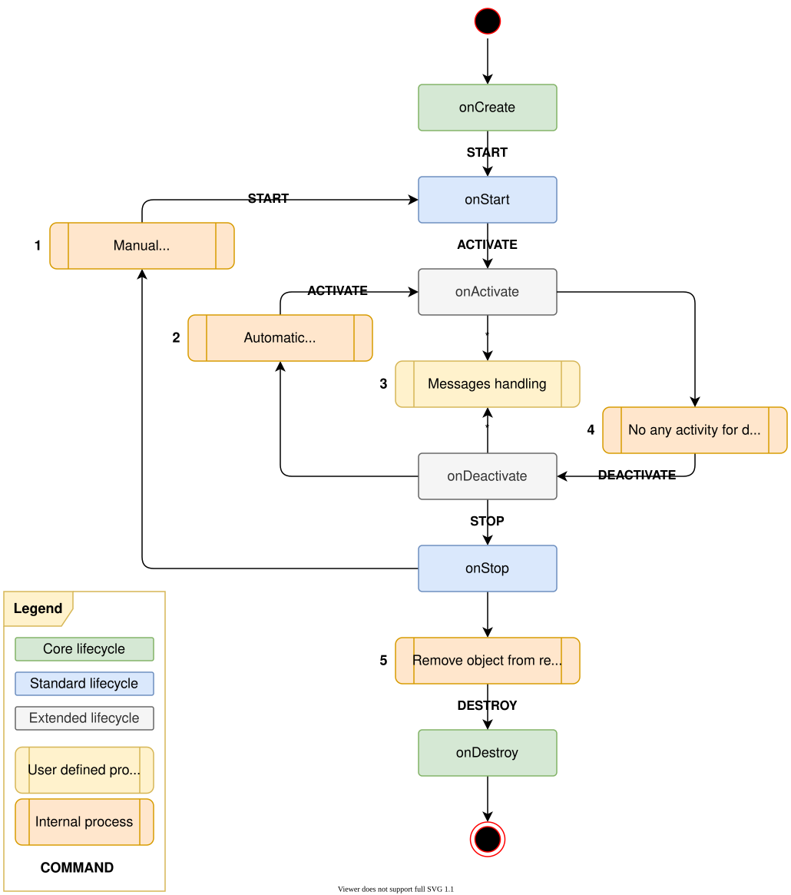
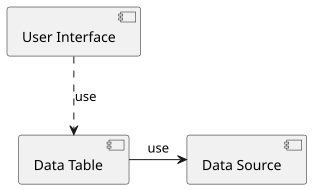
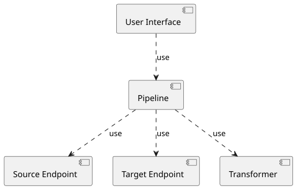

# Process · Active Objects · [ActO]

An implementation variant of Active Objects with the following features:

- **Asynchronous Method Calls**: Methods are executed asynchronously, allowing the caller to continue executing other tasks.
- **Thread Safety**: Ensures that method calls are thread-safe and do not interfere with each other.
- **Request Queue Management**: Efficiently manages the request queue to ensure that requests are processed in the correct order.
- **Backpressure**: Bounded per-object queues with `FAIL` (reject) or `BLOCK` (wait) overflow policies.
- **Message Deadlines**: `request()` futures time out, and messages that timed out or were cancelled are skipped instead of executed for a caller that has given up.
- **Dependency Control**: Ensures strong dependency control between objects.
- **Customizable Lifecycles**: Allows customization of object lifecycles, including initialization and termination.
- **Single Dispatcher**: Uses a single dispatcher to manage all active objects.
- **Observability**: `DispatcherMetrics` hooks with an optional Micrometer backend; dispatch threads are named after the object they serve.
- **Validated Configuration**: `DispatcherConfig.builder()` rejects non-positive timeouts at build time.
- **JPMS-ready**: explicit `devmix.process.acto.api` / `devmix.process.acto.core` modules with a minimal export surface.

## Download

Artifact can be downloaded from [Maven Central](https://central.sonatype.com/artifact/com.github.devmix.process.acto/devmix-process-acto-core).

See [CHANGELOG.md](CHANGELOG.md) for release notes and the 0.1.x → 0.2.0 migration guide.

```xml
<dependency>
    <groupId>com.github.devmix.process.acto</groupId>
    <artifactId>devmix-process-acto-core</artifactId>
    <version>0.2.0</version>
</dependency>
```

## Configuration

`DefaultActiveObjectsDispatcher` accepts an immutable `DispatcherConfig`:

```java
final var dispatcher = new DefaultActiveObjectsDispatcher(DispatcherConfig.builder()
        .idleTimeout(Duration.ofMinutes(10))
        .heartbeatInterval(Duration.ofMinutes(1))
        .build());
```

| Parameter | Default | Description |
|-----------|---------|-------------|
| `heartbeatInterval` | 5 min | how often the heartbeat checks objects for idle |
| `idleTimeout` | 5 min | inactivity time before an object is deactivated |
| `waitMessagesTimeout` | 500 ms | how long the dispatch task waits for new messages before terminating |
| `messageTimeout` | 0 | default deadline for `request()` futures; timed-out or cancelled messages are skipped; `0` = disabled |
| `destroyTimeout` | 15 s | how long `destroy()` waits for the object to be destroyed |
| `dependencyStartTimeout` | 15 s | how long the start of a dependency is awaited |
| `dependencyStopTimeout` | 15 s | how long the stop of a dependency is awaited |
| `debugLifecycleLogging` | `false` | log lifecycle events on the INFO level (otherwise DEBUG) |
| `queueCapacity` | `0` | maximum number of queued user messages per object; `0` = unlimited |
| `queueOverflowPolicy` | `FAIL` | `FAIL` rejects new messages with `QueueOverflowException`; `BLOCK` waits for a free slot |
| `metrics` | `DispatcherMetrics.NOOP` | observability hooks: processed/rejected messages, queue depth, destroyed objects; optional `MicrometerDispatcherMetrics` backend |

## Example

Create and send message (`getCounter`) to an [EchoObject](core/src/test/java/com/github/devmix/process/acto/fixtures/EchoObject.java) / [EchoOptions](core/src/test/java/com/github/devmix/process/acto/fixtures/EchoOptions.java):

```java
final var dispatcher = new DefaultActiveObjectsDispatcher();

ActiveObject<EchoObject> obj = dispatcher
        .create(EchoObject::new, "object-id", new EchoOptions(false, 0));

Long counter = obj.get(EchoObject::getCounter).get();
```

## Use Cases

A catalog of runnable, tested patterns by domain — ERP/ECM, fintech/HFT, logistics, EdTech,
MarTech, MedTech, observability, ETL, BI and more, each rated for how well it fits the
active object pattern — see [examples/README.md](examples/README.md).

## Object Lifecycle



### Usage Examples



- **User Interface**: Provides access to the data table from the user interface.
- **Data Table**: Represents the data table that can be in different states (e.g., migration, creation, deletion, etc.).
  It depends on the Data Source.
- **Data Source**: Represents the data source that can be in different states (e.g., creation, connecting, closed,
  etc.). It depends on the Data Table and interacts with external resources such as databases or file systems.

The **Data Table** and **Data Source** are active objects that can be in different states. The main problem we need to
solve is how to manage their lifecycles and dependencies, ensuring proper initialization of the **Data Source** before
the **Data Table** is used.

More complex example with ETL pipeline:



- **User Interface**: Provides access to the pipeline from the user interface.
- **Pipeline**: Represents a data processing pipeline that can be in different states (e.g., running, paused, stopped,
  etc.). It depends on the **Source Endpoint**, **Transformer**, and **Target Endpoint**.
- **Source Endpoint**: Represents a source endpoint that can be in different states (e.g., connecting, connected,
  disconnected, etc.). It interacts with external resources such as databases or file systems.
- **Transformer**: Represents a transformer that can be in different states (e.g., processing, paused, stopped, etc.).
  It depends on internal scripts or services.
- **Target Endpoint**: Represents a target endpoint that can be in different states (e.g., connecting, connected,
  disconnected, etc.). It interacts with external resources such as databases or file systems.

The **Pipeline**, **Source Endpoint**, **Transformer**, and **Target Endpoint** are active objects.

## Synthetic Example

A runnable end-to-end demo (dependency graph, forced stop, 1M-message load test) with full
source and console output: [docs/synthetic-example.md](docs/synthetic-example.md).
